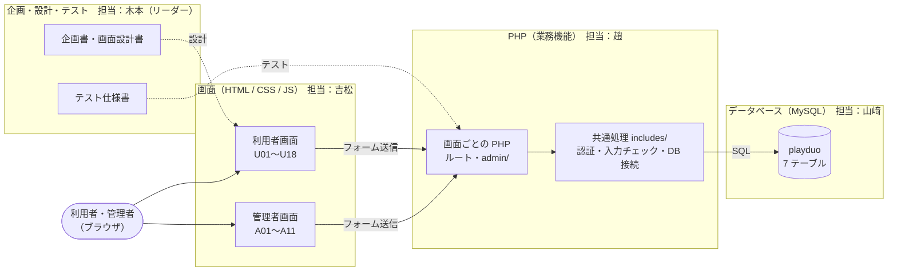

# Play Duo

友達と一緒に始める PC ゲーム専門店（システム開発演習Ⅰ チーム開発・マルチラボ）。
PHP / HTML / CSS / JavaScript / MySQL（フレームワークなし）。

> **【全員へ】データベースの作り直しを 1 回お願いします**
>
> 会員登録とログインのために、テーブルの定義が変わりました。前に `playduo` データベースを作った人は、そのままだと会員登録とログインがエラーになります。
> 下の「データベースを作り直す（全員が 1 回やること）」の手順を、全員 1 回やってください。

---

## 構成と担当



| 担当 | 受け持ち |
|---|---|
| 木本（リーダー） | 企画書、画面設計（吉松と共同）、テスト仕様書、成果物の提出、週報 |
| 吉松 | 画面設計（木本と共同）、共通部品と画面の実装（HTML / CSS / JS） |
| 山﨑 | 機能一覧、ER 図、エンティティ定義書、DB 構築とテストデータ |
| 趙 | 業務フロー図、CRUD 図、開発環境、業務機能の実装（PHP） |

画面と PHP をつなぐ約束ごと（ファイル名・`name`・変数名）は `docs/画面とPHPの対応表.md` にあります。

---

## はじめての人へ：自分の PC で動かすまで（約 20 分）

**ゴール**：ブラウザで `http://localhost/playduo/tools/db_check.php` を開いて
「**OK：playduo に接続しました**」と出ること。出たら準備完了です。

上から順番にやってください。Windows と Mac で違うところは分けて書いてあります。

### ステップ 1：ソフトを 2 つ入れる（最初の 1 回だけ）

| ソフト | 何に使う | ダウンロード |
|---|---|---|
| **XAMPP** | PHP と MySQL を自分の PC で動かす | https://www.apachefriends.org/jp/ |
| **Git** | GitHub からソースを持ってくる | Windows：https://git-scm.com/downloads ／ Mac：下の説明 |

- **XAMPP**：インストーラーの設定は全部そのまま「次へ」でよい
- **Git（Windows）**：インストーラーの設定は全部そのまま「Next」でよい
- **Git（Mac）**：「ターミナル」アプリを開いて `git --version` と打つ。入っていなければ「インストールしますか？」と出るので「インストール」を押す

### ステップ 2：ソースを持ってくる（clone）

XAMPP の **`htdocs` フォルダ**の中に置きます。ここに置いたものだけがブラウザで開けます。

**Windows**：スタートメニューで「cmd」と検索して「コマンドプロンプト」を開き、1 行ずつコピーして Enter

```
cd C:\xampp\htdocs
git clone https://github.com/TK88101/PlayDuo.git playduo
```

**Mac**：「ターミナル」を開き、1 行ずつコピーして Enter

```
cd /Applications/XAMPP/xamppfiles/htdocs
git clone https://github.com/TK88101/PlayDuo.git playduo
```

> Mac で `Permission denied` と出たら、代わりに次の 2 行を打つ（パスワードは Mac のログインパスワード。打っても画面には何も出ないが、そのまま Enter）
> ```
> sudo git clone https://github.com/TK88101/PlayDuo.git playduo
> sudo chown -R "$(whoami)" playduo
> ```

終わると `htdocs` の中に `playduo` フォルダができています。

### ステップ 3：接続設定ファイルを作る

`config` フォルダの中の `config.sample.php` を**コピー**して、名前を `config.php` にします。
ステップ 2 と同じ画面で、続けて打ってください。

**Windows**

```
cd playduo
copy config\config.sample.php config\config.php
```

**Mac**

```
cd playduo
cp config/config.sample.php config/config.php
```

中身は書き換えなくて大丈夫です（XAMPP の初期設定に合わせてあります）。
`config.php` は人によって中身が違うファイルなので、GitHub には上がらないようになっています。

### ステップ 4：XAMPP を起動して、データベースを作る

1. XAMPP のコントロールパネルを開く
   - Windows：スタートメニューの「XAMPP Control Panel」
   - Mac：アプリケーション → XAMPP → `manager-osx`（「Manage Servers」タブ）
2. **Apache** と **MySQL** の「Start」を押す（Windows は名前が緑色になれば OK、Mac は「Running」になれば OK）
3. ブラウザで http://localhost/phpmyadmin/ を開く
4. 左上の「**新規作成**」をクリック（英語表示なら「New」）
5. データベース名に `playduo` と入力、右の選択欄で `utf8mb4_general_ci` を選んで「作成」（英語表示なら「Create」）

### ステップ 5：確認

ブラウザで http://localhost/playduo/tools/db_check.php を開く。

「**OK：playduo に接続しました**」と出れば接続は完了です。
「NG」と出たら、下の「うまくいかないとき」を見てください。

この時点ではデータベースは空です。続けて、下の「データベースを作り直す（全員が 1 回やること）」でテーブルとテストデータを入れてください。

---

## うまくいかないとき

| 症状 | 原因と直し方 |
|---|---|
| `git` が見つからない／認識されない | Git が入っていない。ステップ 1 をやり直し、**コマンドプロンプトを一度閉じて開き直す** |
| Apache が Start できない（赤字のエラー） | 他のソフトがポート 80 を使っている。Skype などを終了して再挑戦。だめなら班のチャットで相談 |
| MySQL が Start できない | 別の MySQL が動いている。PC を再起動してから XAMPP だけ起動してみる |
| ページが「Not Found」 | フォルダの場所か名前が違う。`htdocs` の中に `playduo`（小文字）があるか確認 |
| NG：`config/config.php がありません` | ステップ 3 をやっていない |
| NG：`Unknown database 'playduo'` | ステップ 4 のデータベース作成をやっていない（名前のつづりも確認） |
| NG：`Connection refused`／`No such file or directory`／`対象のコンピューターによって拒否` | MySQL が起動していない。ステップ 4 の 2 を確認 |
| NG：`Access denied for user 'root'` | MySQL に自分でパスワードを設定している人だけ。`config/config.php` の `password` にそのパスワードを書く |

解決しないときは、**エラーの画面のスクショ**を班のチャットに貼ってください。

---

## 2 回目からの始め方

1. XAMPP で **Apache** と **MySQL** を Start
2. `main` に切り替えて、最新のソースを取り込む（`playduo` フォルダで）

   ```
   git switch main
   git pull
   ```

   `sql/schema.sql` が更新されていたら、下の「データベースを作り直す」をもう一度やる。

3. 自分の作業用に新しいブランチを作る（`main` には直接 push しない）

   ```
   git switch -c feature/作業の名前
   ```

4. 作業が終わったら commit して push する

   ```
   git add 変更したファイル
   git commit -m "変更の説明"
   git push -u origin feature/作業の名前
   ```

5. GitHub で `main` 宛ての Pull request を出す（確認してからマージします）
6. XAMPP で Stop を押してよい

毎回 2 から始めてください。古い `main` からブランチを作ると、マージのときにぶつかります。

---

## データベースを作り直す（全員が 1 回やること）

会員登録とログインのために、`members` に列が 2 つ（`totp_secret`・`totp_last_step`）、テーブルが 1 つ（`recovery_codes`）増えました。
前に作った `playduo` データベースにはこれが入っていません。`db_check.php` が「OK」でも中身は古いままで、会員登録とログインがエラーになります。

**すでにデータベースを作った人も、下の手順を 1 回やってください。**

> **注意**：`playduo` データベースは一度消えて、作り直しになります。自分で入れたデータを残したい人は、先に phpMyAdmin の「エクスポート」で保存してください。

1. 最新のソースを取り込む（`playduo` フォルダで）

   ```
   git switch main
   git pull
   ```

2. XAMPP で **Apache** と **MySQL** を Start
3. ブラウザで http://localhost/phpmyadmin/ を開く
4. 上の「**インポート**」タブを開く（左でデータベースを選ばなくてよい）
5. 「ファイルを選択」で `sql/schema.sql` を選び、一番下の「インポート」を押す（テーブルが 7 つできる）
   - Windows：`C:\xampp\htdocs\playduo\sql\schema.sql`
   - Mac：`/Applications/XAMPP/xamppfiles/htdocs/playduo/sql/schema.sql`
6. 同じやり方で `sql/seed.sql` を流す（商品 8 件と管理者 1 名が入る。何度流しても件数は変わらない）
7. 確認する：左の `playduo` を開くとテーブルが 7 つあり、`members` の「構造」に `totp_secret` と `totp_last_step` がある

順番は必ず `schema.sql` → `seed.sql` です。逆にするとエラーになります。

次に作り直すのは、`sql/schema.sql` が更新されたときだけです。テーブルを変えたいときは `sql/schema.sql` を直して Pull request を出してください。

管理者の開発用ログイン：ID `admin` ／ パスワード `admin1234`（ローカル専用）

## テストの回し方（PHP 担当向け）

[Composer](https://getcomposer.org/) が必要です。

```
composer install
php vendor/bin/phpunit
```

- テストは専用の `playduo_test` データベースだけを使います（開発用の `playduo` には触れません）。最初に 1 回だけ MySQL で用意してください：
  ```sql
  CREATE DATABASE playduo_test DEFAULT CHARACTER SET utf8mb4 COLLATE utf8mb4_general_ci;
  CREATE USER 'playduo_test'@'localhost' IDENTIFIED BY 'playduo_test';
  GRANT ALL PRIVILEGES ON playduo_test.* TO 'playduo_test'@'localhost';
  ```
- カバレッジ（80% 以上で合格）は pcov 入りの PHP で `composer coverage`

---

## フォルダ構成

| フォルダ | 内容 |
|---|---|
| `config/` | 接続設定（`config.php` は各自で作る） |
| `/`（ルート） | 利用者画面の PHP（1 画面＝1 ファイル） |
| `includes/` | 共通 PHP（`db.php`＝DB 接続、`header.php`・`footer.php` など） |
| `assets/` | ゲーム画像・商品データ・JS |
| `sql/` | `schema.sql`（テーブル定義）・`seed.sql`（テストデータ） |
| `tests/` | 自動テスト（PHPUnit） |
| `docs/` | 業務フロー図・画面と PHP の対応表などの資料 |
| `tools/` | 開発用ツール（`db_check.php` など） |

## 決まりごと

- DB へのアクセスは `includes/db.php` の `db()` を使い、SQL は必ずプリペアドステートメントで書く
- 画面に出す値は `htmlspecialchars()` でエスケープする
